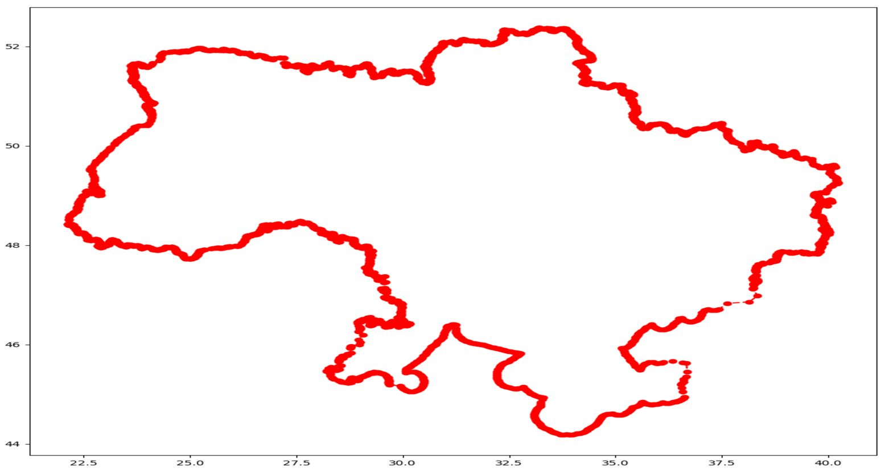
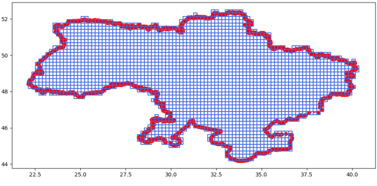
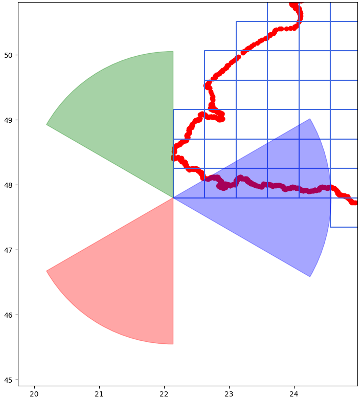
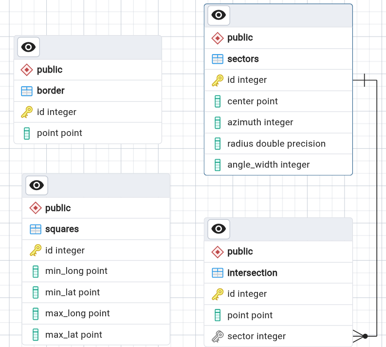

Невеликий проект, орієнтований на ознайомлення з базовими поняттями геоданих та способами їх представлення в структурах даних

Задача 1: Побудувати кордон на основі точок з заданими географічними координатами\
**Результат**:\

Задача 2: Розбити загальну площу України на квадрати однакового розміру **Результат**:\

Задача 3: З вершини квадрату побудувати 3 сектори 60 градусів радіуса 100 км.\
**Результат**:\

Задача 4: Зберегти отримані результати в реляційній БД\
**ER-діаграма**:\

Було використано тип даних **point** для зберігання координат точок. В таблиці border\
збережено точки кордону, а в squares - розбиваючих квадратів. В sectors збері-\
гаються координати центру сектору та його параметри, а в intersection - точки,\
що увійшли до певного сектору
